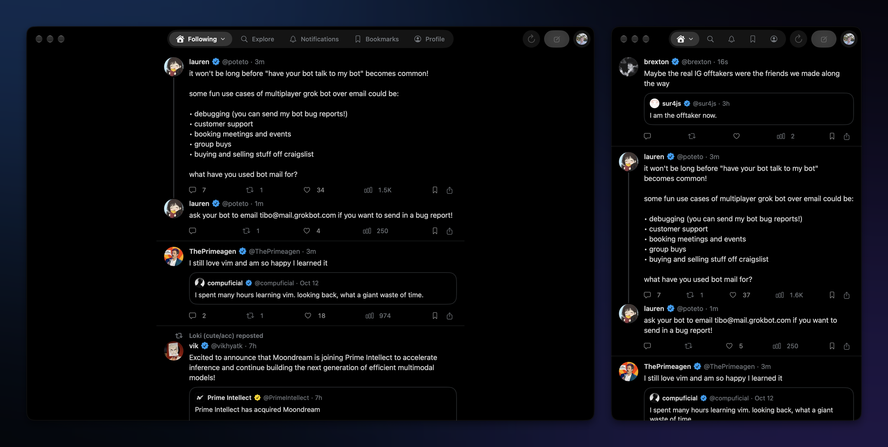
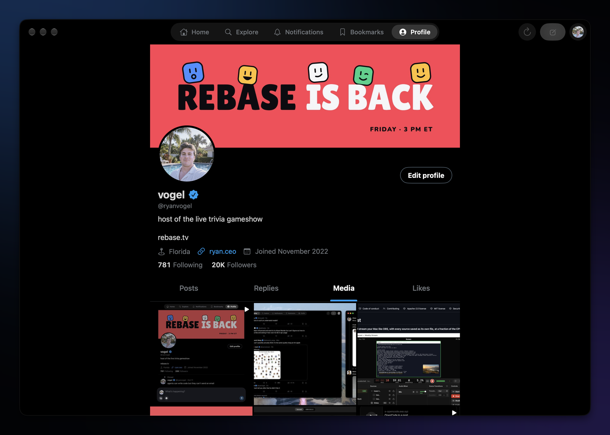
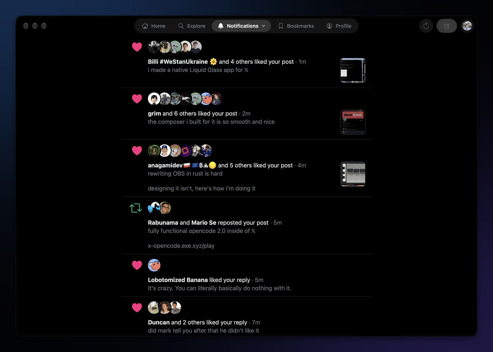
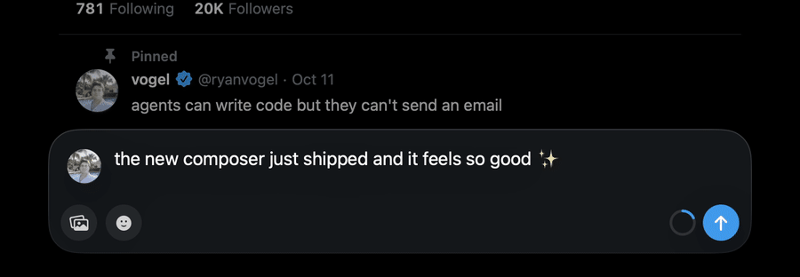
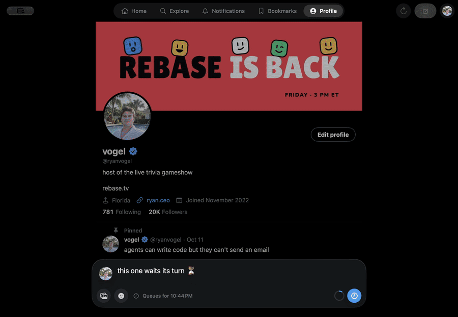
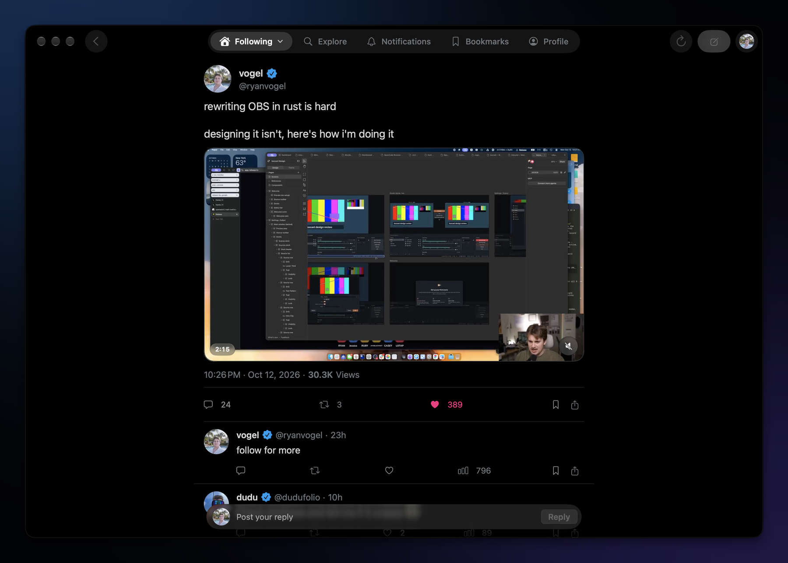
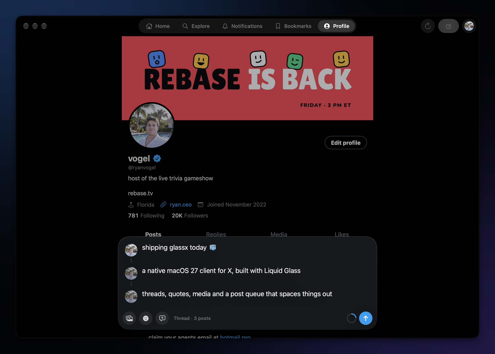

<p align="center">
  
</p>

<h1 align="center">GlassX</h1>

<p align="center">
  A fully native X client for macOS 27, built with SwiftUI and Liquid Glass.<br>
  <a href="https://github.com/R44VC0RP/glassx/releases/latest"><b>Download the latest release</b></a>
</p>



GlassX is a pure-black, keyboard-friendly X (Twitter) client that feels like it shipped with the Mac. Navigation floats on a single Liquid Glass bar, the feed runs edge to edge underneath, and everything — the timeline, threads, profiles, notifications, posting — is drawn natively instead of in a web view.

> [!NOTE]
> GlassX is an independent project, not affiliated with or endorsed by X Corp. It talks to the same private web API that x.com uses, signed in as you. That API isn't documented or supported by X, can change at any time, and automated use of it may conflict with X's Terms of Service. Use it on your own account at your own risk.

## Features

### Reading

- **Live timeline.** For You and Following check for new posts every 45 seconds. At the top they slide in; scrolled down, a "new posts" pill appears without moving what you're reading. Come back after a minute away and you get a fresh feed.
- **Smooth infinite scroll.** The next page loads well before you reach the bottom, and images are downsampled and cached off the main thread.
- **Videos and GIFs autoplay muted** while they're on screen, with a mute toggle and a full-size viewer.
- **Threads, quotes, link cards and media** rendered the way x.com shows them, with thread lines that connect replies.
- **Notifications that mirror x.com**: stacked avatars, bold names, post previews, and All / Priority / Mentions.
- **Profiles** with Posts, Replies, a Media grid and (on your own profile) Likes, plus Follow, Mute and Block.
- **Search** with Top / Latest, and Bookmarks.
- **Keeps your place** in each tab when you switch away and back.
- Resizes all the way down to a single narrow column.

<p>
  
  
</p>

### Posting

- **A composer docked at the bottom of the window**, like a chat prompt. Add up to four photos or one GIF or video by attaching, dragging in, or pasting (⌘V).
- **Threads**: press ⇧⌘↩ or the + button to add the next post; they're sent in order, each replying to the last.
- **Quote posts** from the repost menu, the right-click menu, or **Q**.
- **Space out my posts** (Settings › ⌘,): write as many posts as you like and GlassX queues them, sending one at a time at least 15 minutes to 4 hours apart, only during the hours you choose. Replies can still go out right away.
- Your own posts can be deleted, pinned to your profile, or copied as an image.

<p>
  
  
</p>

<p>
  
  
</p>

### Keyboard

| Key | Action |
| --- | --- |
| <kbd>J</kbd> / <kbd>K</kbd> | Next / previous post |
| <kbd>Return</kbd> or <kbd>O</kbd> | Open the selected post |
| <kbd>L</kbd> · <kbd>R</kbd> · <kbd>T</kbd> · <kbd>Q</kbd> · <kbd>B</kbd> | Like · reply · repost · quote · bookmark |
| <kbd>U</kbd> | Open the author's profile |
| <kbd>.</kbd> | Back to the top |
| <kbd>Esc</kbd> | Go back |
| <kbd>⌘N</kbd> | New post |
| <kbd>⌘↩</kbd> / <kbd>⇧⌘↩</kbd> | Post / add to thread |
| <kbd>⌘1</kbd>–<kbd>⌘5</kbd> | Home, Explore, Notifications, Bookmarks, Profile |
| <kbd>⌥⌘1</kbd> / <kbd>⌥⌘2</kbd> | For You / Following |
| <kbd>⌘R</kbd> | Refresh |

## Install

1. Download **GlassX.dmg** from the [latest release](https://github.com/R44VC0RP/glassx/releases/latest).
2. Open it and drag GlassX to Applications. The app is signed with a Developer ID and notarized by Apple, so it opens without warnings.
3. Click **Sign in with X** and sign in on x.com inside the app.

Requires **macOS 27** on an Apple silicon Mac.

> [!TIP]
> X's passkey sign-in doesn't work inside an app's built-in web view (Apple only allows that for browsers). Sign in with your password and an authenticator code instead; you only need to do it once.

## How it works

GlassX has no server and no API key. Everything happens on your Mac:

- **Sign-in.** You sign in on x.com in a private, sandboxed web view. When X sets your session cookies, GlassX stores them in your macOS Keychain and closes the web view. They are only ever sent to x.com and upload.x.com.
- **The API.** X's web client calls a GraphQL API whose query IDs and feature flags change every few weeks. Instead of hard-coding them, GlassX reads them from x.com's own JavaScript bundles at runtime, caches them for six hours, and refreshes automatically when X rejects a request.
- **Request signing.** Some operations (search, for example) require an `x-client-transaction-id` header that x.com generates in the browser. GlassX ports that algorithm to Swift ([`TransactionID.swift`](GlassX/API/TransactionID.swift)) and was verified to match the reference implementations byte for byte.
- **Media** is uploaded with the same chunked `upload.x.com` flow the website uses.
- **The post queue** lives in the app's sandbox and sends while GlassX is open. If the app was closed when a post came due, it carries on spacing posts out when you reopen it rather than sending them all at once.

GlassX is sandboxed and only requests network access and read access to files you pick.

## Build from source

You need Xcode 27 and [XcodeGen](https://github.com/yonaskolb/XcodeGen).

```sh
brew install xcodegen
git clone https://github.com/R44VC0RP/glassx.git
cd glassx
xcodegen generate
open GlassX.xcodeproj
```

By default the app is signed to run locally. To sign with your own certificate, create `Config/Local.xcconfig` (it's gitignored):

```
CODE_SIGN_IDENTITY = Apple Development: Your Name (XXXXXXXXXX)
```

[`scripts/release.sh`](scripts/release.sh) builds a Developer ID–signed, notarized DMG and zip into `dist/`. It needs `SIGN_IDENTITY`, plus an App Store Connect API key in `NOTARY_KEY`, `NOTARY_KEY_ID` and `NOTARY_ISSUER`.

## Credits

The `x-client-transaction-id` generator is ported from [iSarabjitDhiman/XClientTransaction](https://github.com/iSarabjitDhiman/XClientTransaction) and [Lqm1/x-client-transaction-id](https://github.com/Lqm1/x-client-transaction-id), both MIT licensed.

## License

[MIT](LICENSE)
